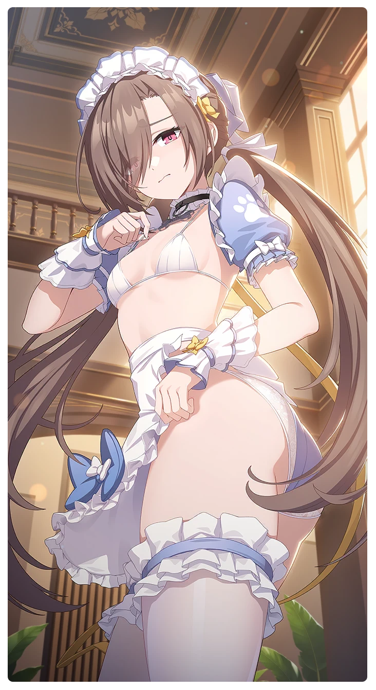

# これが…服？

所持キャラクター: [リディア](../キャラクター/リディア-西部奪還隊.md) ／ レアリティ: **SSR**

## メインステータス

| 種別 | 内容 |
| --- | --- |
| メインステータス | 力 |
| アシスト | 会心率 / 救援者 |

## 救援者効果

**特別なコディネート**

絆ポイントが50以上の場合 感応トレーニングの発生率の上昇 +140

**レベル解放:** 1 / 34 / 35 / 40 / 45 / 50

## 救援の旅データ（レベル1）

救援の旅開始効果
力
+5
潜在力ポイント増加
+9
絆ポイント増加
+11
トレーニング効果
トレーニングの効果上昇
+15.44%
追加潜在力ポイントの獲得
+2
超感応トレーニング効果
感応トレーニングの発生率の上昇
+80
超感応トレーニングの効果上昇
+19.48%
イベント
同族の匂い
成功
+10 力
平常心の鍛錬
妄想の資格条件
成功
+15 力
+10 体力
+10 潜在力ポイント
攻撃の腕前
平常心はメイド服とともに
もう十分だよ。そこまでにしよう。
成功
+12 力
+8 体力
+20 潜在力ポイント
空虚の手振り
約束は約束だから…もう少しだけやってみよう。
成功
+12 力
+8 体力
+15 スタミナ
空虚の手振り

© Studio B-Side
