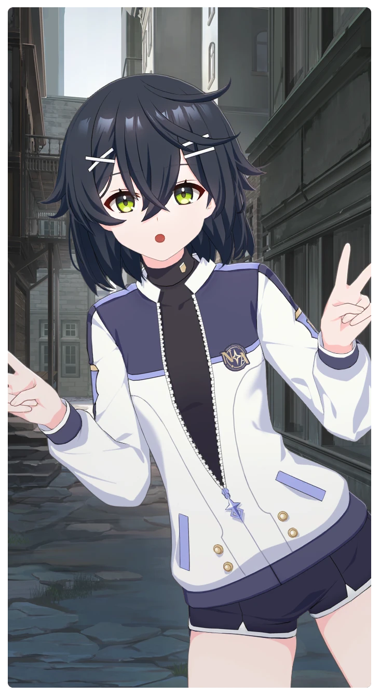

# ご注文はスマイルで

所持キャラクター: [スマイル](../キャラクター/スマイル-ボイジャー救援団.md) ／ レアリティ: **R**

## メインステータス

| 種別 | 内容 |
| --- | --- |
| メインステータス | 集中 |

**レベル解放:** 1 / 34 / 35 / 40 / 45 / 50

## 救援の旅データ（レベル1）

救援の旅開始効果
集中
+1
トレーニング効果
トレーニングの効果上昇
+7.04%
超感応トレーニング効果
感応トレーニングの発生率の上昇
+150
超感応トレーニングの効果上昇
+11.44%
イベント
運命
成功
+3 集中
+3 スタミナ

© Studio B-Side
