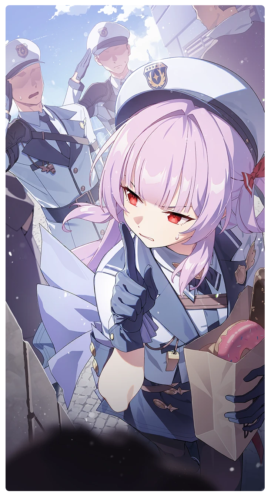

# アンダーカバー・コップ

所持キャラクター: [アンナ](../キャラクター/アンナ-NOAのタウンガード.md) ／ レアリティ: **SSR**

## メインステータス

| 種別 | 内容 |
| --- | --- |
| メインステータス | 忍耐 |
| アシスト | 強靭度 / 共用 |

## 救援者効果

**常時パトロール**

絆ポイントが50以上の場合 古のコイン獲得量上昇 +5.00%

**レベル解放:** 1 / 34 / 35 / 40 / 45 / 50

© Studio B-Side
