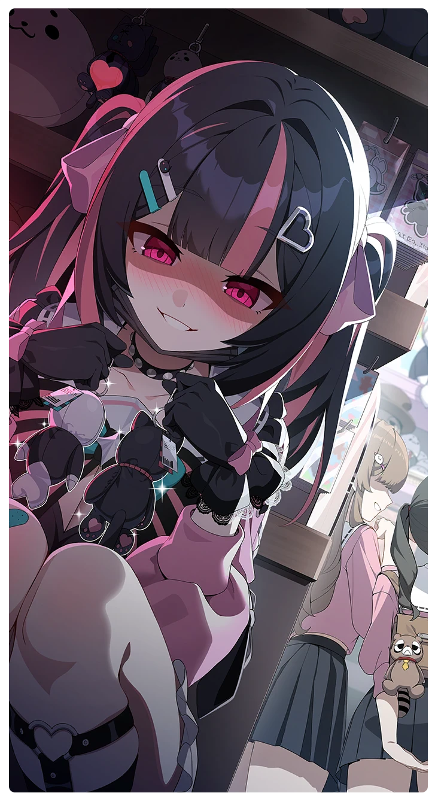

# キラくらい可愛い！

所持キャラクター: [キラ](../キャラクター/キラ-キラには友達なんていないの.md) ／ レアリティ: **SSR**

## メインステータス

| 種別 | 内容 |
| --- | --- |
| メインステータス | 力 |
| アシスト | 速度 / アサシン |

## 救援者効果

**一人の時間**

絆ポイントが70以上の場合 コンディション効果上昇 +3.00%

**レベル解放:** 1 / 34 / 35 / 40 / 45 / 50

## 救援の旅データ（レベル1）

救援の旅開始効果
潜在力ポイント増加
+8
絆ポイント増加
+3
トレーニング効果
トレーニングの効果上昇
+13.76%
超感応トレーニング効果
感応トレーニングの発生率の上昇
+375
超感応トレーニングの効果上昇
+24.84%
依頼効果
古のコイン獲得量上昇
+3.5%
イベント
キラクラ
成功
+10 力
+5 体力
+5 集中
-10 スタミナ
竜族は丈夫だからな！
成功
+10 力
-10 スタミナ
+20 潜在力ポイント
入るのは勝手だけど…
力ずくで開ける。
成功
+12 力
+8 集中
弾力・加速
失敗
+10 力
-10 スタミナ
弾力・加速
運命を受け入れる。
成功
+5 力
弾力・加速

© Studio B-Side
