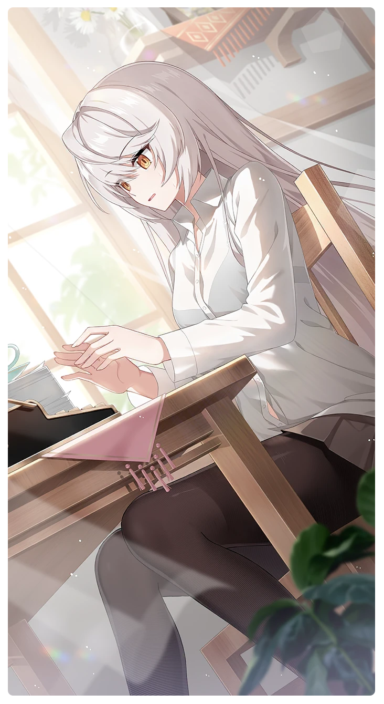

# ノスタルジアの逆襲

所持キャラクター: [ヒルデ](../キャラクター/ヒルデ-フェンリル小隊.md) ／ レアリティ: **SSR**

## メインステータス

| 種別 | 内容 |
| --- | --- |
| メインステータス | 忍耐 |
| アシスト | 特殊効果 / ディフェンダー |

## 救援者効果

**指揮官の姿**

絆ポイントが60以上の場合 追加忍耐ステータス獲得 +1

**レベル解放:** 1 / 34 / 35 / 40 / 45 / 50

## 救援の旅データ（レベル1）

救援の旅開始効果
潜在力ポイント増加
+8
絆ポイント増加
+3
トレーニング効果
トレーニングの効果上昇
+10.4%
コンディション効果上昇
+9.5%
超感応トレーニング効果
感応トレーニングの発生率の上昇
+275
超感応トレーニングの効果上昇
+19.48%
イベント
報告書は難しい
成功
+20 潜在力ポイント
防御の感覚
責任を持てない子ども心
リンが用意した物を受ける。
成功
+1 コンディション
+20 忍耐
防御の腕前
作戦方針
失敗
+25 体力
-10 スタミナ
床に転がっている人形を指す。
成功
+15 スタミナ
+1 コンディション
トレーニングは実戦のごとく
病気のフリをする！
成功
-10 スタミナ
+25 忍耐
+20 潜在力ポイント
沈黙の盾
適当にごまかす！
成功
+5 力
+10 体力
沈黙の盾

© Studio B-Side
