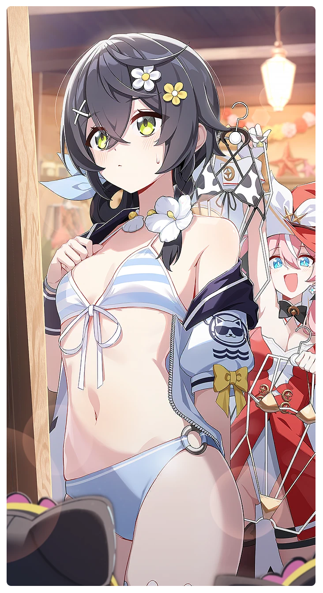

# バカンスの準備はお買い物から！

所持キャラクター: [スマイル](../キャラクター/スマイル-ボイジャー救援団.md) ／ レアリティ: **SSR**

## メインステータス

| 種別 | 内容 |
| --- | --- |
| メインステータス | 力 |
| アシスト | 特殊効果 / 救援者 |

## 救援者効果

**クーリングブースト**

絆ポイントが50以上の場合 感応トレーニングの発生率の上昇 +150

**レベル解放:** 1 / 34 / 35 / 40 / 45 / 50

## 救援の旅データ（レベル1）

救援の旅開始効果
集中
+6
絆ポイント増加
+14
トレーニング効果
追加力ステータス獲得
+1
トレーニングの効果上昇
+10.4%
コンディション効果上昇
+7.6%
追加潜在力ポイントの獲得
+2
超感応トレーニング効果
超感応トレーニングの効果上昇
+19.48%
イベント
種の進化
頭をそっと撫でてみよう。
成功
+10 力
+10 潜在力ポイント
今だ！アセラみたいにお腹を触るんだ！
成功
+20 集中
+10 潜在力ポイント
笑いの調査
成功
+10 力
+10 集中
攻撃の腕前
二人だけの秘密
成功
+12 力
+5 体力
+10 集中
速度の感覚
笑い誘発メカニズム

© Studio B-Side
