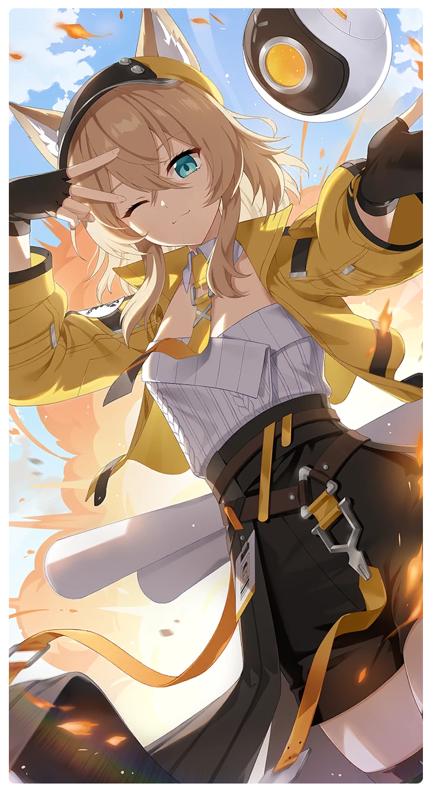

# メイド・バイ・ペトラ♡

所持キャラクター: [ペトラ](../キャラクター/ペトラ-ペトラ組合.md) ／ レアリティ: **SSR**

## メインステータス

| 種別 | 内容 |
| --- | --- |
| メインステータス | 集中 |
| アシスト | 会心率 / 共用 |

## 救援者効果

**実業家のコネ**

絆ポイントが60以上の場合 感応トレーニングの発生率の上昇 +130

**レベル解放:** 1 / 34 / 35 / 40 / 45 / 50

## 救援の旅データ（レベル1）

救援の旅開始効果
集中
+5
潜在力ポイント増加
+9
絆ポイント増加
+9
トレーニング効果
トレーニングの効果上昇
+12.08%
コンディション効果上昇
+7.6%
超感応トレーニング効果
超感応トレーニングの効果上昇
+19.48%
イベント
雨の日
成功
+10 力
+10 体力
集中の感覚
代表の苦悩
露を宿したバラ色…？
成功
+5 力
+5 体力
+12 集中
-10 スタミナ
攻撃の感覚
瑞々しいグレープフルーツのオレンジ色……？
成功
+10 スタミナ
ペトラのサイズ理論
成功
+8 力
+8 体力
+15 集中
-10 スタミナ
洞察の聖痕

© Studio B-Side
