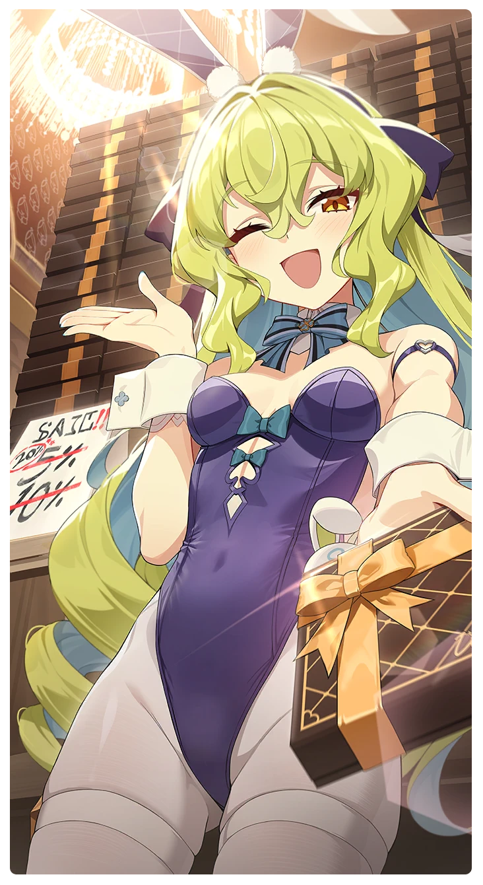

# 不屈の傑作

所持キャラクター: [フレイ](../キャラクター/フレイ-モナスティル騎士団.md) ／ レアリティ: **SSR**

## メインステータス

| 種別 | 内容 |
| --- | --- |
| メインステータス | 力 |
| アシスト | 会心ダメージ / 共用 |

## 救援者効果

**効果的なマーケティング**

絆ポイントが40以上の場合 感応トレーニングの発生率の上昇 +140

**レベル解放:** 1 / 34 / 35 / 40 / 45 / 50

## 救援の旅データ（レベル1）

救援の旅開始効果
潜在力ポイント増加
+4
絆ポイント増加
+12
トレーニング効果
追加力ステータス獲得
+1
トレーニングの効果上昇
+13.76%
追加潜在力ポイントの獲得
+3
超感応トレーニング効果
超感応トレーニングの効果上昇
+19.48%
イベント
ヘッドハンティング
成功
+10 力
+10 スタミナ
+15 潜在力ポイント
攻撃の感覚
フレスマ
成功
+15 力
+10 体力
+20 潜在力ポイント
攻撃の腕前
このカードにすべてを賭けて！
フレイの勝利を予想する。
成功
+10 力
+15 スタミナ
+20 潜在力ポイント
頑丈な破壊
失敗
+10 力
+15 スタミナ
散財
+30 潜在力ポイント
頑丈な破壊
ルナの勝利を予想する。
成功
+10 体力
+10 忍耐
+10 潜在力ポイント
頑丈な破壊

© Studio B-Side
