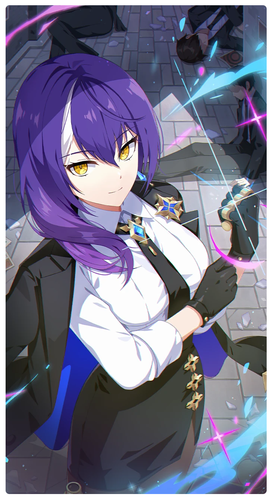

# 会話終了

所持キャラクター: [ロベルタ](../キャラクター/ロベルタ-軌道捜索隊.md) ／ レアリティ: **SR**

## メインステータス

| 種別 | 内容 |
| --- | --- |
| メインステータス | 保護 |

**レベル解放:** 1 / 34 / 35 / 40 / 45 / 50

## 救援の旅データ（レベル1）

救援の旅開始効果
絆ポイント増加
+6
トレーニング効果
トレーニングの効果上昇
+7.04%
超感応トレーニング効果
感応トレーニングの発生率の上昇
+185
超感応トレーニングの効果上昇
+11.44%
依頼効果
古のコイン獲得量上昇
+4.2%
イベント
恋人
成功
+3 保護
+3 スタミナ
あの事件の後日談
成功
+8 保護
+5 潜在力ポイント
伝説の剣
成功
+15 保護
+10 潜在力ポイント

© Studio B-Side
