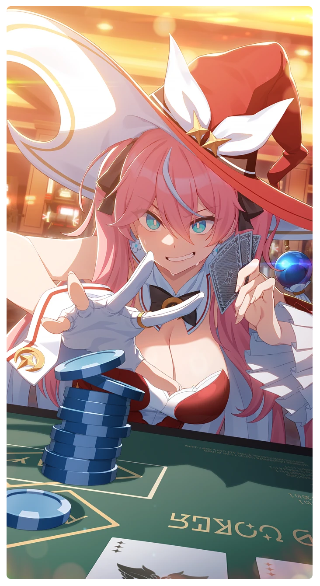

# 光を追え！

所持キャラクター: [ルナ](../キャラクター/ルナ-ボイジャー救援団.md) ／ レアリティ: **SSR**

## メインステータス

| 種別 | 内容 |
| --- | --- |
| メインステータス | 力 |
| アシスト | 特殊効果 / 救援者 |

## 救援者効果

**ブレイブガール・ロード**

絆ポイントが50以上の場合 追加力ステータス獲得 +1

**レベル解放:** 1 / 34 / 35 / 40 / 45 / 50

## 救援の旅データ（レベル1）

救援の旅開始効果
力
+6
絆ポイント増加
+11
トレーニング効果
トレーニングの効果上昇
+12.08%
コンディション効果上昇
+3.94%
追加潜在力ポイントの獲得
+3
超感応トレーニング効果
感応トレーニングの発生率の上昇
+105
超感応トレーニングの効果上昇
+22.16%
イベント
何でも聞いてくださいな
成功
+12 力
+8 集中
生存王
未来は手の中に
成功
+20 潜在力ポイント
攻撃の腕前
カモ
成功
+15 力
+25 潜在力ポイント
運命の道

© Studio B-Side
