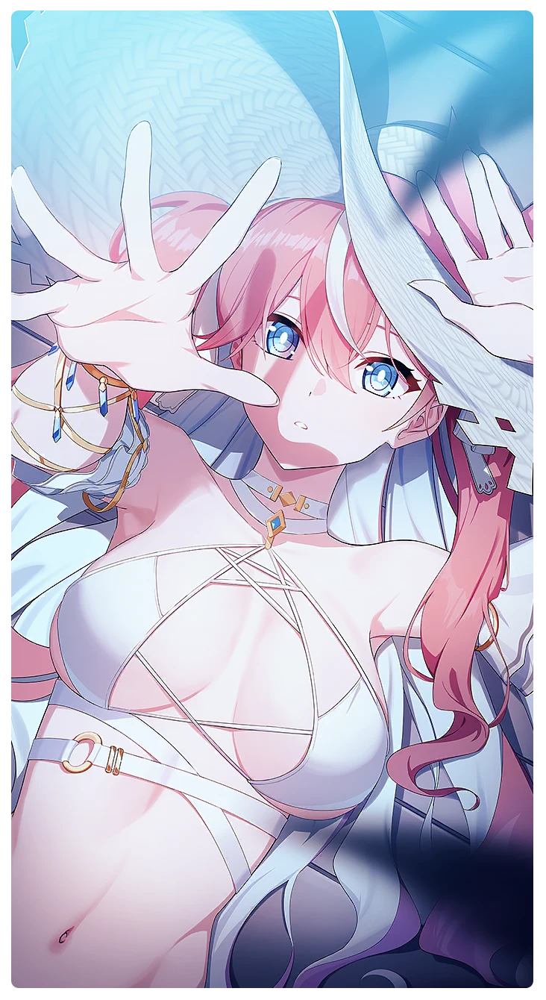

# 夏の夜の空

所持キャラクター: [ルナ](../キャラクター/ルナ-ボイジャー救援団.md) ／ レアリティ: **SSR**

## メインステータス

| 種別 | 内容 |
| --- | --- |
| メインステータス | 体力 |
| アシスト | 特殊効果 / ディフェンダー |

## 救援者効果

**ささやかな奇跡**

絆ポイントが30以上の場合 トレーニングの効果上昇 +8.00%

**レベル解放:** 1 / 34 / 35 / 40 / 45 / 50

## 救援の旅データ（レベル1）

救援の旅開始効果
絆ポイント増加
+12
トレーニング効果
追加体力ステータス獲得
+1
トレーニングの効果上昇
+10.4%
コンディション効果上昇
+3%
超感応トレーニング効果
感応トレーニングの発生率の上昇
+375
超感応トレーニングの効果上昇
+24.84%
イベント
何でも聞いてくださいな
成功
+10 体力
+8 集中
防御の腕前
未来は手の中に
成功
+12 体力
+10 集中
集中の才能
これは修行だ！
成功
+12 体力
+15 集中
確固な信頼

© Studio B-Side
