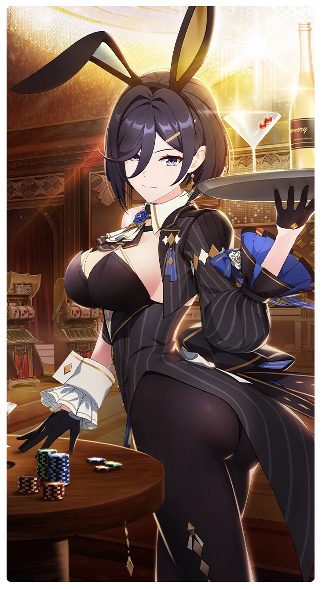

# 完璧なバニーガール

所持キャラクター: [クレア](../キャラクター/クレア-キャンドル・スクエア.md) ／ レアリティ: **SSR**

## メインステータス

| 種別 | 内容 |
| --- | --- |
| メインステータス | 体力 |
| アシスト | HP / 共用 |

## 救援者効果

**完璧な仕事ぶり**

絆ポイントが40以上の場合 古のコイン獲得量上昇 +5.00%

**レベル解放:** 1 / 34 / 35 / 40 / 45 / 50

## 救援の旅データ（レベル1）

救援の旅開始効果
体力
+6
絆ポイント増加
+8
トレーニング効果
トレーニングの効果上昇
+17.12%
コンディション効果上昇
+5.1%
超感応トレーニング効果
感応トレーニングの発生率の上昇
+225
超感応トレーニングの効果上昇
+27.52%
イベント
サプライズパーティー
成功
+15 体力
生命の腕前
バイクホッグはですね…
成功
+10 スタミナ
+10 潜在力ポイント
ウサギの隣にウサギの隣にウサギ
正直に打ち明ける。
成功
+5 力
+10 体力
-10 スタミナ
+15 潜在力ポイント
鋭い成長
失敗
+5 力
+5 体力
-10 スタミナ
+10 潜在力ポイント
鋭い成長
適当にごまかす。
成功
+10 スタミナ
+10 潜在力ポイント
生命の才能

© Studio B-Side
