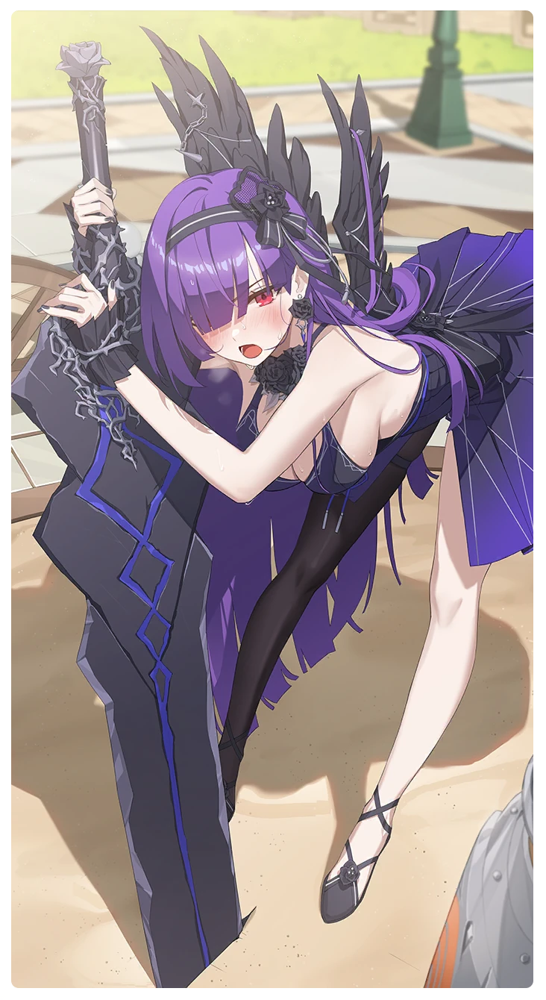

# 弱点補完カスタム特訓

所持キャラクター: [ティリア](../キャラクター/ティリア-執行者.md) ／ レアリティ: **SSR**

## メインステータス

| 種別 | 内容 |
| --- | --- |
| メインステータス | 力 |
| アシスト | 攻撃力 / 共用 |

## 救援者効果

**隠した黒い翼**

絆ポイントが30以上の場合 トレーニングの効果上昇 +8.00%

**レベル解放:** 1 / 34 / 35 / 40 / 45 / 50

## 救援の旅データ（レベル1）

救援の旅開始効果
絆ポイント増加
+11
トレーニング効果
追加力ステータス獲得
+2
トレーニングの効果上昇
+15.44%
コンディション効果上昇
+9.5%
超感応トレーニング効果
感応トレーニングの発生率の上昇
+275
超感応トレーニングの効果上昇
+22.16%
イベント
伝説の鳥を探して
成功
+10 力
+5 体力
+1 コンディション
お客様は神様！
うん、今日は早く帰ろう。
成功
+15 スタミナ
それでも閉店時間は守らないと。
成功
+10 力
+8 体力
-5 スタミナ
責任感
相手役をお願い
成功
+12 力
+8 体力
+10 スタミナ
鋭い攻勢

© Studio B-Side
