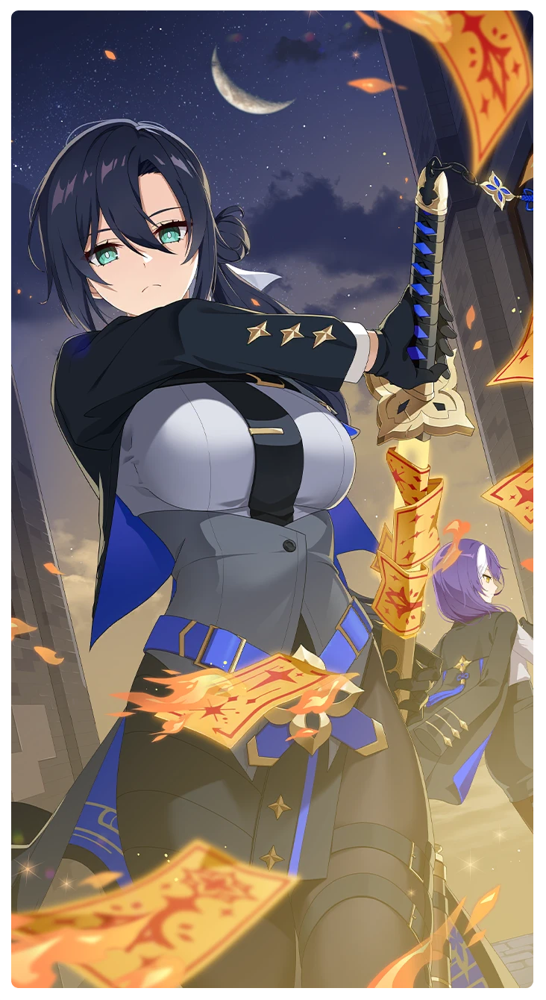

# 後始末

所持キャラクター: [ルー](../キャラクター/ルー-軌道捜索隊.md) ／ レアリティ: **SR**

## メインステータス

| 種別 | 内容 |
| --- | --- |
| メインステータス | 集中 |

**レベル解放:** 1 / 34 / 35 / 40 / 45 / 50

## 救援の旅データ（レベル1）

救援の旅開始効果
潜在力ポイント増加
+7
絆ポイント増加
+6
トレーニング効果
トレーニングの効果上昇
+7.04%
コンディション効果上昇
+3%
超感応トレーニング効果
超感応トレーニングの効果上昇
+11.44%
イベント
運命
成功
+3 集中
+3 スタミナ
安全キャンペーン
成功
+8 集中
+10 潜在力ポイント
体重はただの数字
成功
+12 集中
集中の感覚

© Studio B-Side
