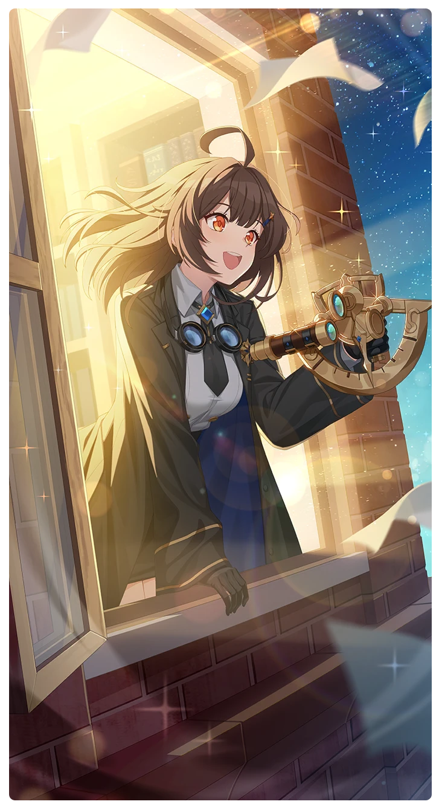

# 星を見ながら夢を

所持キャラクター: [ナル](../キャラクター/ナル-軌道捜索隊.md) ／ レアリティ: **SSR**

## メインステータス

| 種別 | 内容 |
| --- | --- |
| メインステータス | 集中 |
| アシスト | 会心率 / 共用 |

## 救援者効果

**無我夢中**

絆ポイントが60以上の場合 追加集中ステータス獲得 +1

**レベル解放:** 1 / 34 / 35 / 40 / 45 / 50

## 救援の旅データ（レベル1）

救援の旅開始効果
絆ポイント増加
+12
トレーニング効果
トレーニングの効果上昇
+10.4%
トレーニング出現確率上昇
+6%
コンディション効果上昇
+5.9%
超感応トレーニング効果
感応トレーニングの発生率の上昇
+260
超感応トレーニングの効果上昇
+16.8%
イベント
でも早かったですよね！
成功
+8 力
+10 集中
エリートフェイスです！
成功
+1 コンディション
+10 力
+10 集中
手ほどきしましょう！
成功
+10 力
-10 スタミナ
+10 集中
洞察の聖痕

© Studio B-Side
