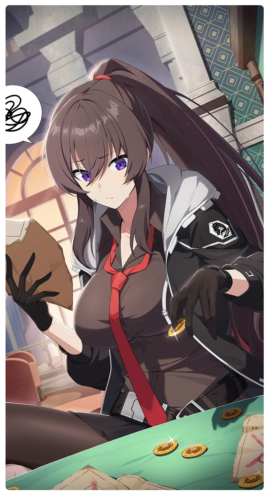

# 歴戦の傭兵

所持キャラクター: [ヤナギ・ミナ](../キャラクター/ヤナギ・ミナ-フェンリル小隊.md) ／ レアリティ: **SSR**

## メインステータス

| 種別 | 内容 |
| --- | --- |
| メインステータス | 体力 |
| アシスト | 特殊効果 / 救援者 |

## 救援者効果

**猪突猛進**

絆ポイントが50以上の場合 追加体力ステータス獲得 +1

**レベル解放:** 1 / 34 / 35 / 40 / 45 / 50

## 救援の旅データ（レベル1）

救援の旅開始効果
体力
+5
絆ポイント増加
+11
トレーニング効果
トレーニングの効果上昇
+10.4%
体力トレーニング経験値の獲得量アップ
+3.5%
コンディション効果上昇
+3.94%
超感応トレーニング効果
感応トレーニングの発生率の上昇
+275
超感応トレーニングの効果上昇
+24.84%
イベント
世の中そう甘くない
他の仕事をしてみよう！
成功
+15 スタミナ
美味しいものを食べて忘れよう！
成功
+1 コンディション
+10 潜在力ポイント
深刻なワーカホリック
その頃の生活パターンを再現してみるのはどう？
成功
+40 潜在力ポイント
もっとしっかり休もう。
成功
破壊の腕前
フェンリル小隊
成功
+15 体力
+12 忍耐
カタリスト

© Studio B-Side
