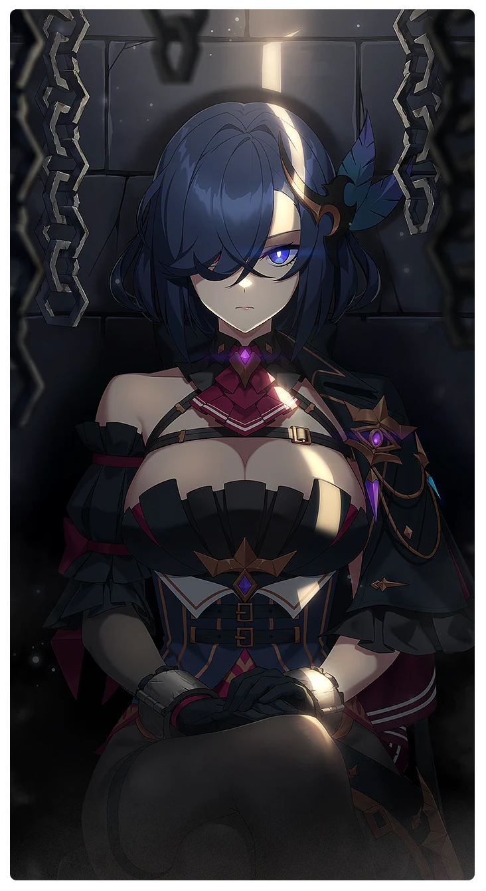

# 永遠なる束縛の連鎖

所持キャラクター: [クリステル](../キャラクター/クリステル-モレル海運商会.md) ／ レアリティ: **SSR**

## メインステータス

| 種別 | 内容 |
| --- | --- |
| メインステータス | 集中 |
| アシスト | 攻撃力 / 共用 |

## 救援者効果

**冷めぬ熱望**

絆ポイントが40以上の場合 追加集中ステータス獲得 +1

**レベル解放:** 1 / 34 / 35 / 40 / 45 / 50

## 救援の旅データ（レベル1）

救援の旅開始効果
集中
+3
トレーニング効果
追加力ステータス獲得
+2
トレーニングの効果上昇
+15.44%
トレーニング出現確率上昇
+6%
コンディション効果上昇
+7.6%
超感応トレーニング効果
超感応トレーニングの効果上昇
+19.48%
イベント
運命に向き合う姿勢
成功
+10 力
+5 集中
+5 スタミナ
攻撃の感覚
エデよ、パパだぞ！
きっと演技に違いない。
成功
+15 力
+8 体力
+12 集中
集中の腕前
失敗
+15 力
+8 集中
集中の腕前
とりあえず謝るべきじゃないか？
成功
+15 力
+12 集中
+1 コンディション
失敗
+15 力
+12 集中
服を溶かす薬
成功
+15 力
+12 集中
+10 スタミナ
攻撃の聖痕

© Studio B-Side
