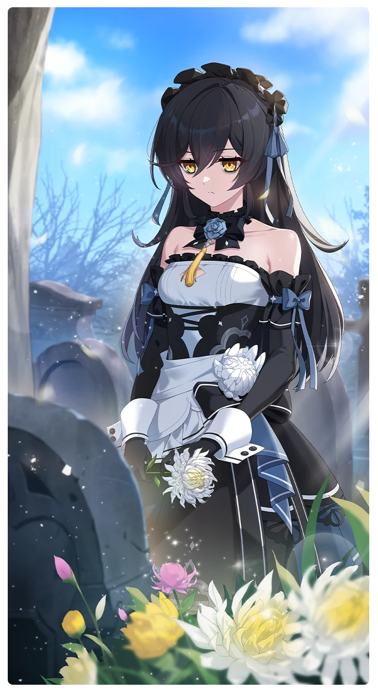

# 深い哀悼

所持キャラクター: [ベル・リース](../キャラクター/ベル・リース-キャンドル・スクエア.md) ／ レアリティ: **SSR**

## メインステータス

| 種別 | 内容 |
| --- | --- |
| メインステータス | 集中 |
| アシスト | 会心率 / レンジャー |

## 救援者効果

**持ちつ持たれつ**

絆ポイントが40以上の場合 感応トレーニングの発生率の上昇 +150

**レベル解放:** 1 / 34 / 35 / 40 / 45 / 50

## 救援の旅データ（レベル1）

救援の旅開始効果
潜在力ポイント増加
+8
絆ポイント増加
+9
トレーニング効果
トレーニングの効果上昇
+12.08%
コンディション効果上昇
+3%
超感応トレーニング効果
超感応トレーニングの効果上昇
+19.48%
追加集中ステータス獲得
+3
イベント
R.I.P.
成功
+5 集中
+10 スタミナ
縞模様
ベルの石の方が綺麗だと思うけど？
成功
+5 集中
+10 潜在力ポイント
集中の腕前
探しに行こう！
成功
+5 力
+10 潜在力ポイント
集中の腕前
プライドの高い二人の戦い
危険な呪術は使わないんだよな？
成功
+10 力
+15 集中
+15 潜在力ポイント
蚕食の影
失敗
+8 力
+12 集中
+10 潜在力ポイント
蚕食の影
ベル・リース。薬を渡して、走れ。
成功
+20 スタミナ

© Studio B-Side
