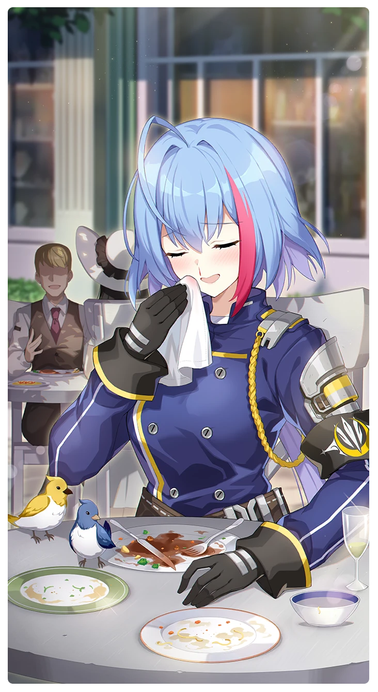

# 満足のいく食事

所持キャラクター: [ベスタ](../キャラクター/ベスタ-西部奪還隊.md) ／ レアリティ: **SSR**

## メインステータス

| 種別 | 内容 |
| --- | --- |
| メインステータス | 保護 |
| アシスト | 強靭度 / ディフェンダー |

## 救援者効果

**模範隊員**

絆ポイントが60以上の場合 古のコイン獲得量上昇 +5.00%

**レベル解放:** 1 / 34 / 35 / 40 / 45 / 50

## 救援の旅データ（レベル1）

救援の旅開始効果
絆ポイント増加
+12
トレーニング効果
追加保護ステータス獲得
+1
トレーニングの効果上昇
+8.72%
コンディション効果上昇
+5.9%
超感応トレーニング効果
感応トレーニングの発生率の上昇
+105
超感応トレーニングの効果上昇
+24.84%
イベント
異なる角度
成功
+5 集中
+10 スタミナ
+10 潜在力ポイント
保護の感覚
誰かにとっては貴重なもの
本を開いてみる。       
成功
+10 スタミナ
ベスタに譲る。
成功
+8 体力
+8 集中
+12 保護
-10 スタミナ
失敗
+15 保護
-10 スタミナ
ベスタの戦術説明
ベスタを止める。
成功
+8 体力
+8 集中
+15 保護
強靭な意志
失敗
+8 体力
+8 集中
+15 保護
-20 スタミナ
強靭な意志
ただ見守る。  
成功
+15 保護
強靭な意志

© Studio B-Side
