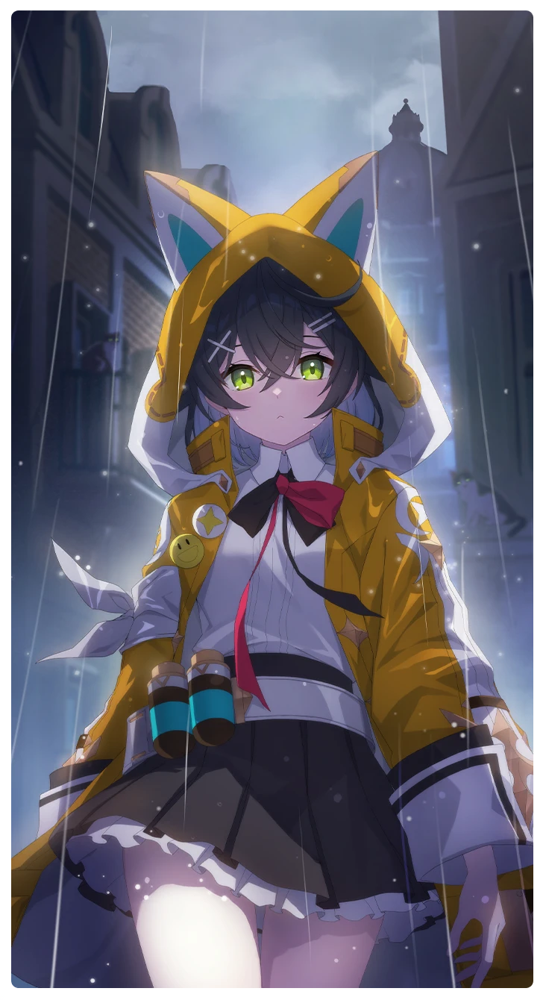

# 猫は笑わない

所持キャラクター: [スマイル](../キャラクター/スマイル-ボイジャー救援団.md) ／ レアリティ: **SR**

## メインステータス

| 種別 | 内容 |
| --- | --- |
| メインステータス | 集中 |

**レベル解放:** 1 / 34 / 35 / 40 / 45 / 50

## 救援の旅データ（レベル1）

救援の旅開始効果
集中
+1
トレーニング効果
トレーニングの効果上昇
+10.4%
超感応トレーニング効果
感応トレーニングの発生率の上昇
+150
超感応トレーニングの効果上昇
+14.12%
依頼効果
古のコイン獲得量上昇
+2.7%
イベント
魔術師
成功
+5 集中
種の進化
頭をそっと撫でてみよう。
成功
+8 集中
+5 保護
+1 コンディション
失敗
+8 集中
-10 スタミナ
今だ！アセラみたいにお腹を触るんだ！
成功
+8 集中
+5 スタミナ
笑いの調査
成功
+12 集中
+10 スタミナ

© Studio B-Side
