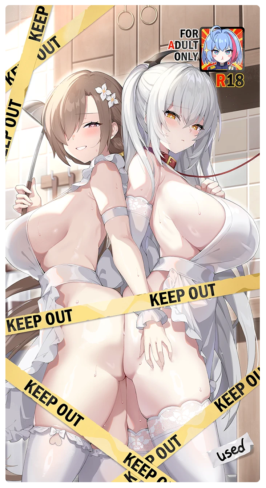

# 禁断の記録物 Vol.1

所持キャラクター: [ベスタ](../キャラクター/ベスタ-西部奪還隊.md) ／ レアリティ: **SSR**

## メインステータス

| 種別 | 内容 |
| --- | --- |
| メインステータス | 体力 |

## 救援者効果

**これから本気を出すから**

絆ポイントが50以上の場合 トレーニングの効果上昇 +5.00%

**レベル解放:** 1 / 34 / 35 / 40 / 45 / 50

## 救援の旅データ（レベル1）

救援の旅開始効果
体力
+9
絆ポイント増加
+9
トレーニング効果
トレーニングの効果上昇
+13.76%
追加潜在力ポイントの獲得
+2
超感応トレーニング効果
感応トレーニングの発生率の上昇
+70
超感応トレーニングの効果上昇
+19.48%
イベント
闇から生まれ、光を誓った
いや、夢にしては あまりにもリアルだった。
成功
+5 力
+5 体力
+5 忍耐
そうだな。だからあんな夢を 見たのかもしれない。
成功
+5 スタミナ
+5 潜在力ポイント
禁断の記録物 Vol.1
成功
+5 体力
+5 忍耐
+5 潜在力ポイント
声優ラジオがあれば嬉しいな、みたいな
成功
-5 スタミナ
+1 コンディション
+10 体力
メタ認知

© Studio B-Side
