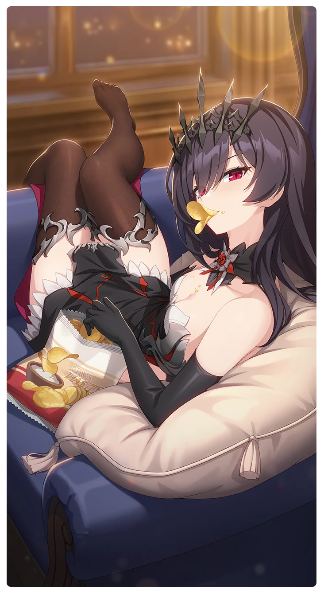

# 終末は少女の顔をしている

所持キャラクター: [ロザリア](../キャラクター/ロザリア-フォーレン・ホーク.md) ／ レアリティ: **SSR**

## メインステータス

| 種別 | 内容 |
| --- | --- |
| メインステータス | 力 |
| アシスト | 攻撃力 / レンジャー |

## 救援者効果

**魔王の恩恵**

絆ポイントが30以上の場合 追加力ステータス獲得 +2

**レベル解放:** 1 / 34 / 35 / 40 / 45 / 50

## 救援の旅データ（レベル1）

救援の旅開始効果
絆ポイント増加
+11
トレーニング効果
トレーニングの効果上昇
+12.08%
コンディション効果上昇
+5.9%
追加潜在力ポイントの獲得
+3
超感応トレーニング効果
感応トレーニングの発生率の上昇
+105
超感応トレーニングの効果上昇
+24.84%
イベント
偏食の魔王様
成功
+15 力
+15 集中
洞察の才能
運命の相手…？
成功
+15 力
+15 集中
+10 スタミナ
+30 潜在力ポイント
僕バトル！
成功
+20 力
+10 忍耐
+15 集中
血の響き

© Studio B-Side
