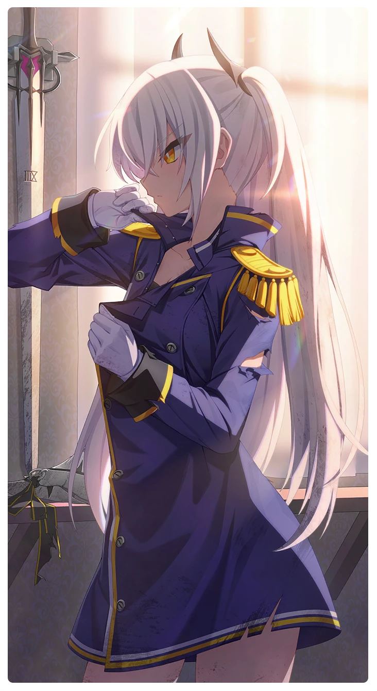

# 見えない場所

所持キャラクター: [セレス](../キャラクター/セレス-西部奪還隊.md) ／ レアリティ: **SSR**

## メインステータス

| 種別 | 内容 |
| --- | --- |
| メインステータス | 集中 |
| アシスト | 特殊効果 / 共用 |

## 救援者効果

**毒には毒を**

絆ポイントが50以上の場合 追加集中ステータス獲得 +1

**レベル解放:** 1 / 34 / 35 / 40 / 45 / 50

## 救援の旅データ（レベル1）

救援の旅開始効果
古のコイン増加
+17
絆ポイント増加
+9
トレーニング効果
トレーニングの効果上昇
+8.72%
追加潜在力ポイントの獲得
+3
超感応トレーニング効果
感応トレーニングの発生率の上昇
+275
超感応トレーニングの効果上昇
+22.16%
イベント
力を得たいか
成功
+15 集中
基準の違い
成功
+8 体力
+15 集中
集中の感覚
深刻なトレーニング中毒です
成功
+20 集中
応急処置

© Studio B-Side
