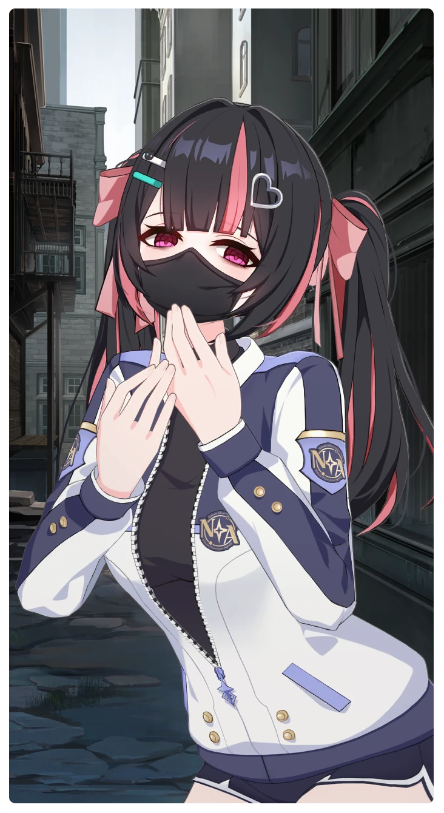

# 言霊の少女

所持キャラクター: [キラ](../キャラクター/キラ-キラには友達なんていないの.md) ／ レアリティ: **R**

## メインステータス

| 種別 | 内容 |
| --- | --- |
| メインステータス | 集中 |

**レベル解放:** 1 / 34 / 35 / 40 / 45 / 50

## 救援の旅データ（レベル1）

救援の旅開始効果
集中
+1
古のコイン増加
+9
トレーニング効果
トレーニングの効果上昇
+7.04%
超感応トレーニング効果
超感応トレーニングの効果上昇
+11.44%
イベント
魔術師
成功
+5 集中

© Studio B-Side
