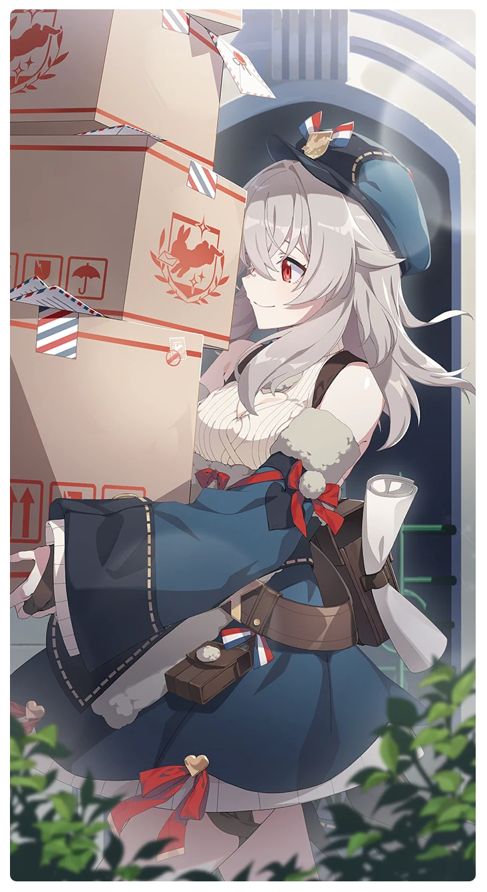

# 誰よりもプロフェッショナル

所持キャラクター: [ベラ](../キャラクター/ベラ-配達屋協会.md) ／ レアリティ: **SSR**

## メインステータス

| 種別 | 内容 |
| --- | --- |
| メインステータス | 体力 |
| アシスト | 特殊効果 / サポーター |

## 救援者効果

**ベテラン配達屋**

絆ポイントが60以上の場合 感応トレーニングの発生率の上昇 +130

**レベル解放:** 1 / 34 / 35 / 40 / 45 / 50

## 救援の旅データ（レベル1）

救援の旅開始効果
潜在力ポイント増加
+11
絆ポイント増加
+11
トレーニング効果
追加体力ステータス獲得
+1
トレーニングの効果上昇
+12.08%
コンディション効果上昇
+3%
超感応トレーニング効果
超感応トレーニングの効果上昇
+19.48%
イベント
飛んで火に入る夏の虫
成功
+5 体力
+10 忍耐
ベラシールド21
成功
+10 体力
+8 忍耐
すべて経験談です
成功
-5 スタミナ
+12 体力
+8 忍耐
星光の恩恵

© Studio B-Side
