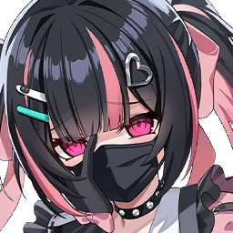

# キラ

**キラには友達なんていないの**

レアリティ: **SSR** ／ 属性: **太陽** ／ クラス: **アサシン** ／ 攻撃タイプ: **精神**

声に力を宿す「言霊」という特殊な能力を持つ少女。幼少期から言霊をうまく制御できず、周囲に迷惑をかけたため、次第に内向的な性格になった。

| 項目 | 内容 |
| --- | --- |
| 誕生日 | 4月4日 |
| 身長 | 155cm |
| 出身 | NOA |
| 所属 | キラには友達なんていないの |
| CV（韓国語） | ソン・イェウォン |
| CV（日本語） | 碧乃梨心 |

**好みの贈り物:** 化粧品 / 花

## スキル

### 肌を切り裂く言霊（パッシブ）

**付与状態:** 潜伏

キラの攻撃力が15％上がる。キラの攻撃時、自身が潜伏状態の場合、ダメージが10％上がる。非日常な挨拶を使用時、自身の点火が最大スタックの場合、全点火スタックを消費して、自身に潜伏を1ターン付与する。

- 攻撃力% +15%

### 非日常的な挨拶（基本スキル）

**付与状態:** 点火 / 潜伏

偶然の衝突を演出して敵を攻撃する。自身に点火スタックを1つ付与する。

- 単体
- ダメージ攻撃力 65%
- ダメージ +8%

### 沈黙の代償（特殊スキル）

**付与状態:** 攻撃力アップ / 点火

言霊を使って不気味な未来を想像させる。自身に攻撃力アップを2ターン付与し、点火スタックを2個付与する。自身が潜伏状態の場合、敵の行動ゲージを20％減らす。沈黙状態の敵を攻撃時、ダメージが30％上がる。

- 単体
- クールタイム: 3
- ダメージ攻撃力 90%
- 強靭度ダメージ1
- ノヴァ1
- ダメージ +9%

### 歪んだ関心（究極スキル）

**付与状態:** 潜伏 / 点火 / 攻撃力ダウン / 沈黙

言霊の力を解放し、敵に不運な結末をもたらす。自身に潜伏を2ターン付与し、点火スタックを2個付与する。敵に100％の確率で攻撃力ダウンを2ターン付与する。さらに、100％の確率で沈黙を1ターン付与する。

- 単体
- クールタイム: 5
- ダメージ攻撃力 115%
- 強靭度ダメージ2
- ノヴァ1
- ダメージ +9%

© Studio B-Side
